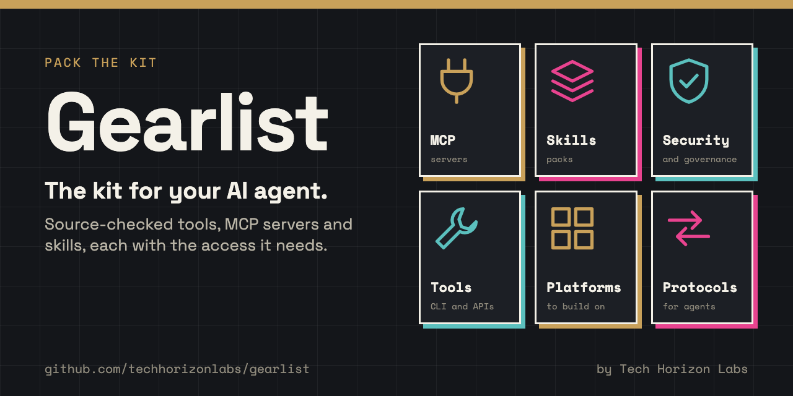

# Gearlist



A source-checked stack of agent tools, MCP servers and skills. Each entry says what it is, who it is for, and the access it needs, so a person can scan it and an agent can load it.

By Tech Horizon Labs. This edition contains 114 entries. Documentation checked means the source was read. It does not mean the software was installed, tested or security audited. Entries are grouped by purpose, in no particular order.

## How to use this

- Human: scan the groups below. The heading is the product. **For** is the audience. **Access and use** is the permission note.
- Agent: load [llms.txt](llms.txt) first, then [llms-full.txt](llms-full.txt) or [resources.json](resources.json). [AGENTS.md](AGENTS.md) is the house rules. Do not install from a row until a human authorises it.

Install the catalog skill with:

```bash
npx skills add techhorizonlabs/gearlist
```

## Contents

- [Agent tools](#agent-tools) (42)
- [MCP and integrations](#mcp-and-integrations) (13)
- [Security and governance](#security-and-governance) (4)
- [Platforms](#platforms) (17)
- [Protocols](#protocols) (4)
- [Skills and learning](#skills-and-learning) (34)


## Agent tools

### [Agent Deck](https://agentdeck.site/)

A Mac interface for coding agent sessions, project context and skills.

**For:** Developers coordinating coding sessions.

**Access and use:** Sessions may run tools with access to local files and connected services.

**Source checked:** 2026-10-25. [Official source](https://agentdeck.site/).

### [Hunk](https://hunk.dev/)

A terminal interface for reviewing code changes with agent notes beside the diff.

**For:** Developers reviewing agent generated changes.

**Access and use:** Review changes before applying them; installation and repository access are separate decisions.

**Source checked:** 2026-10-25. [Official source](https://hunk.dev/).

### [Jevgrep](https://github.com/dzhng/jevgrep)

Search a codebase with a question and receive relevant files and source excerpts.

**For:** Coding agents and developers exploring an unfamiliar repository.

**Access and use:** Requires an AI provider connection; check what repository content is sent to that provider.

**Source checked:** 2026-10-25. [Official source](https://github.com/dzhng/jevgrep).

### [Needle](https://github.com/cactus-compute/needle)

Models and runtimes for local tool calling, structured extraction and embeddings.

**For:** Developers building applications on devices.

**Access and use:** Your application defines and executes the tools; constrain their permissions.

**Source checked:** 2026-10-25. [Official source](https://github.com/cactus-compute/needle).

### [Firecrawl](https://github.com/firecrawl/firecrawl)

Crawl and scrape sites into markdown and structured data for agents.

**For:** Agents and developers who need page content from the public web.

**Access and use:** The hosted API needs a key and spends credits. AGPL-3.0 on the open repository. Do not scrape sites that forbid it. LinkedIn and similar sites may be blocked.

**Source checked:** 2026-10-26. [Official source](https://github.com/firecrawl/firecrawl).

### [REA](https://github.com/morluto/rea)

A local MCP and CLI for investigating application behaviour, from JavaScript bundles to native binaries.

**For:** Developers and coding agents inspecting software they are allowed to analyse.

**Access and use:** Install with npx rea-agents@latest setup. Setup shows a plan and asks before writing agent config or installing Hopper. Native and runtime workflows can execute or attach to programs. DISCLAIMER.md forbids DRM circumvention and copying proprietary software. MIT. npm package rea-agents. MCP registry name io.github.morluto/rea.

**Source checked:** 2026-10-26. [Official source](https://github.com/morluto/rea).

### [OpenCLI](https://opencli.info/)

A CLI and Chrome Browser Bridge that lets agents navigate, click, fill forms and extract from sites through a logged-in Chrome profile.

**For:** People whose agents need to operate websites they are already signed into, or reuse site-specific CLI adapters.

**Access and use:** Install npm package @jackwener/opencli (Node.js 20.18.1 or later) or the desktop app, plus the OpenCLI Chrome extension. Browser commands act through the signed-in Chrome profile, including cookies for the target site. Treat that as the same access the person has in the browser. Apache-2.0. Skills install with npx skills add jackwener/opencli.

**Source checked:** 2026-10-27. [Official source](https://github.com/jackwener/OpenCLI).

### [Graphify](https://www.graphify.com)

Turns a codebase, docs, SQL schemas, configs and PDFs into a local queryable knowledge graph for coding agents.

**For:** People whose agents need a map of a repository without sending the tree to a hosted vector store.

**Access and use:** Install the CLI with uv tool install graphifyy, then graphify install. It reads local project files and writes graphify-out. Apache-2.0.

**Source checked:** 2026-10-27. [Official source](https://github.com/Graphify-Labs/graphify).

### [OpenContext](https://0xranx.github.io/OpenContext/en/)

A local GUI and CLI that stores project context, skills and notes so a coding agent can reuse them across sessions.

**For:** People who already run Claude Code, Codex or OpenCode and want a persistent memory for that work.

**Access and use:** Install with npm install -g @aicontextlab/cli, then oc init in a project. Desktop app from GitHub releases. MIT.

**Source checked:** 2026-10-28. [Official source](https://github.com/0xranx/OpenContext).

### [Stash](https://joinstash.ai)

Captures agent runs and human corrections, then serves that history back as knowledge, skills, REST, MCP and a CLI.

**For:** Teams whose agents should remember lessons from earlier work.

**Access and use:** Python client is pip install stash-sdk. It reads STASH_API_KEY and optional STASH_URL. The GitHub repo is MIT. Hosted and self-hosted paths are separate accounts.

**Source checked:** 2026-10-28. [Official source](https://github.com/Fergana-Labs/stash).

### [Browsentic](https://browsentic.com)

An agentic browser harness: a desktop app, npm CLI and Chrome or Firefox extension that lets an agent drive a signed-in browser.

**For:** People whose agents need to use the browser they already use, including logged-in sites.

**Access and use:** Installer is curl -fsSL https://browsentic.com/install.sh | sh. Read the script before running it. Or npx browsentic@latest setup. The extension acts through the signed-in browser. Apache-2.0.

**Source checked:** 2026-10-28. [Official source](https://github.com/imshaikot/browsentic).

### [Trail-code](https://github.com/trailhq/Trail-Code)

A local map of a codebase plus team learnings, so coding agents go to the right files and pick up earlier decisions.

**For:** People running Claude Code, Cursor, Codex or similar on a repository they control.

**Access and use:** Install with npm install -g @trailhq/trail-code && trail init. It reads the repo on the machine and writes .trail/. MIT.

**Source checked:** 2026-10-28. [Official source](https://github.com/trailhq/Trail-Code).

### [obsidian-wiki](https://github.com/Ar9av/obsidian-wiki)

A local markdown vault an agent can grow, lint and query as a digital brain.

**For:** People who want durable notes an agent can read and write in a folder they own.

**Access and use:** Install with pip install obsidian-wiki, then obsidian-wiki setup --vault ~/brain. MIT. The vault is local files.

**Source checked:** 2026-10-28. [Official source](https://github.com/Ar9av/obsidian-wiki).

### [earshot](https://github.com/Leonxlnx/earshot)

A local CLI, Python API and MCP server that lets coding agents describe, score and generate sound on CPU.

**For:** People whose agents make or review audio, film or game sound without a GPU.

**Access and use:** Python 3.10 or later and ffmpeg on PATH. Clone the repo, venv, CPU torch, then pip install -e ".[mcp,llm,dev]". First model use downloads about 1.1 GB into a local cache. MIT.

**Source checked:** 2026-10-28. [Official source](https://github.com/Leonxlnx/earshot).

### [PromptDirector](https://github.com/wchao6891/PromptDirector)

A free local-first Chrome extension that saves images, prompts and references from the web for later reuse.

**For:** People collecting visual and prompt references while they browse.

**Access and use:** Chrome Web Store listing iahakaahijddcjjldidbclicedibgpjm. Optional local video component. Apache-2.0. Treat saved pages as the same access the signed-in browser has.

**Source checked:** 2026-10-28. [Official source](https://github.com/wchao6891/PromptDirector).

### [ECC](https://ecc.tools)

An agent harness that adds planning, review, memory, skills and AgentShield security scanning to Claude Code and other coding agents.

**For:** People running Claude Code, Codex or similar who want that workflow installed once rather than restated every session.

**Access and use:** Guided setup is npx ecc-universal@2.2.3 setup (Node.js 18 or later). Claude Code plugin is ecc@ecc from github.com/affaan-m/ECC. Install only from those official sources. Hooks run with the agent's permissions. OSS is MIT. ECC Pro GitHub App is a separate paid product for private repos.

**Source checked:** 2026-10-28. [Official source](https://github.com/affaan-m/ECC).

### [Agent Reach](https://github.com/Panniantong/Agent-Reach)

A CLI that gives coding agents read access to platforms generic web search misses, including GitHub, YouTube, Bilibili, V2EX and login-walled social sites.

**For:** People whose agents need those sources, including Chinese platforms and logged-in feeds.

**Access and use:** Point the agent at https://raw.githubusercontent.com/Panniantong/Agent-Reach/main/docs/install.md. The PyPI package named agent-reach is a different project. Login channels copy that site's Chrome session into a dedicated local browser; they do not read the password store. Prefer a secondary account. MIT.

**Source checked:** 2026-10-28. [Official source](https://github.com/Panniantong/Agent-Reach).

### [Ruflo](https://github.com/ruvnet/ruflo)

An agent harness around Claude Code and Codex: plugins, a console, optional MCP, and coordinated multi-agent workflows.

**For:** People who want swarm, memory and policy tools on top of an existing coding agent.

**Access and use:** Prefer npx ruflo@latest init wizard, or in Claude Code /plugin marketplace add ruvnet/ruflo. There is also curl -fsSL https://cdn.jsdelivr.net/gh/ruvnet/ruflo@main/scripts/install.sh | bash. Read the script before running it. Mods run with your account's permissions; review them before installing. MIT.

**Source checked:** 2026-10-28. [Official source](https://github.com/ruvnet/ruflo).

### [agentglass](https://sirallap.github.io/agentglass/)

A local desktop workspace that gathers coding-agent terminals, diffs, pull requests, approvals and a browser they can drive into one window.

**For:** People running Claude Code, Codex, Gemini CLI or OpenCode on their own machine, often several at once.

**Access and use:** Download from GitHub releases. macOS builds are unsigned. Opening it is your call. Data stays in local SQLite. Agents run with your permissions. It controls what they can approve, but it doesn't sandbox them. MIT.

**Source checked:** 2026-10-28. [Official source](https://github.com/SirAllap/agentglass).

### [Oya Browser](https://oyabrowser.com)

A browser people and agents share: desktop app, Node SDK, remote MCP, and optional self-host, with human takeover when a task needs it.

**For:** People whose agents need a signed-in browser they can watch and take over.

**Access and use:** Desktop app from oyabrowser.com. SDK is npm install @oya-ai/browser with OYA_API_KEY. Remote MCP is https://oyabrowser.com/mcp/pool with that key. Self-host installer is curl -fsSL https://raw.githubusercontent.com/OyadotAI/oya-browser/main/install.sh | sh. Read the script before running it. Can reuse logins imported from Chrome, Arc, Brave, Edge or Firefox. SDK and CLI are MIT. The rest of the project is under the Sustainable Use License.

**Source checked:** 2026-10-28. [Official source](https://github.com/OyadotAI/oya-browser).

### [apra-fleet](https://github.com/Apra-Labs/apra-fleet)

A local control plane that registers real machines as fleet members and runs durable multi-agent workflows across Claude, Codex, Copilot and other providers.

**For:** People coordinating coding agents on more than one machine they already own.

**Access and use:** Requires Node.js 22.16 or later. npm install -g @apralabs/apra-fleet, then apra-fleet install and apra-fleet start. MCP is http://localhost:7523/mcp by default. Secrets are entered out of band and never shown to the model. Apache-2.0.

**Source checked:** 2026-10-28. [Official source](https://github.com/Apra-Labs/apra-fleet).

### [CodeGraph](https://colbymchenry.github.io/codegraph/)

A local code knowledge graph that answers with symbols, call paths and blast radius so coding agents spend fewer file reads.

**For:** People whose Claude Code, Cursor, Codex, Gemini, OpenCode, Copilot or similar agent needs a live map of a repository.

**Access and use:** Install with npm i -g @colbymchenry/codegraph, then codegraph install and, in each project, codegraph init. The README also offers curl -fsSL https://raw.githubusercontent.com/colbymchenry/codegraph/main/install.sh | sh. Read the script before running it. Indexes live in .codegraph/ as local SQLite. The installer asks about anonymous usage telemetry; turn it off with codegraph telemetry off. Hosted product waitlist is getcodegraph.com. MIT.

**Source checked:** 2026-10-28. [Official source](https://github.com/colbymchenry/codegraph).

### [Jev Ultrafast](https://github.com/browser-use/jev-ultrafast)

A local Chrome agent from Browser Use. One model chooses each click or field, and a smaller model writes text only when a field needs typing.

**For:** People who want a Chrome agent for a single goal, with a local inspector they can pause before a click.

**Access and use:** Clone the repo, uv sync, then set TYPESAFE_API_KEY and TEXT_MODEL_API_KEY in .env. TEXT_MODEL_API_KEY is an OpenRouter key in the example. Chrome connects through Browser Harness; allow remote debugging when prompted. Owned tabs share your existing Chrome profile. Local inspector is http://127.0.0.1:8766. MIT.

**Source checked:** 2026-10-28. [Official source](https://github.com/browser-use/jev-ultrafast).

### [Boop](https://github.com/chrisgreg/boop)

A self-hosted notification inbox: apps POST events, they land in local SQLite, and an iOS app you build can show them on your phone.

**For:** Developers and agents that need a private event inbox they run themselves.

**Access and use:** Clone then docker compose up, or run a GitHub release binary. Data lives in a local SQLite file. APNs credentials are optional. Set BOOP_ADMIN_USER and BOOP_ADMIN_PASSWORD for the web UI, or put the server behind your own proxy. Read-only MCP is POST /mcp with BOOP_MCP_TOKEN; Settings can turn that endpoint off. You build and sign the iOS app. MIT.

**Source checked:** 2026-10-28. [Official source](https://github.com/chrisgreg/boop).

### [Laya](https://nandhakishorm.github.io/laya/)

A local decision model that answers typed choice, score and yes/no questions over text in one forward pass, with a router that picks a checkpoint per request.

**For:** People whose agents need typed choice, score or yes/no answers over text.

**Access and use:** Python 3.10 or later. python -m pip install laya. The first predict downloads a Hugging Face checkpoint. Optional MCP: pip install "laya[mcp]" then laya-mcp-server. Optional HTTP playground: pip install "laya[serve]". Apache-2.0.

**Source checked:** 2026-10-28. [Official source](https://github.com/NandhaKishorM/laya).

### [BrowserSkill](https://github.com/Tencent/BrowserSkill)

A CLI, Chromium extension and agent skill that drives Chrome or Edge through the profile you are already signed into, in a separate Agent Window.

**For:** People whose agents need to read, click and fill sites they already use, without a separate browser account.

**Access and use:** Installer is curl -fsSL https://raw.githubusercontent.com/Tencent/BrowserSkill/main/install.sh | sh. Read the script before running it. Then install the Chrome or Edge extension, enable the local connection, and run bsk install-skill. The Agent Window shares that profile's website logins. Optional remote pairing uses authenticated WSS from the browser. MIT.

**Source checked:** 2026-10-28. [Official source](https://github.com/Tencent/BrowserSkill).

### [Page Agent](https://alibaba.github.io/page-agent/)

An in-page JavaScript library that lets an LLM read the DOM as text and act on the page it is embedded in.

**For:** People adding a copilot to a site they control, or trying one in the optional Chrome extension.

**Access and use:** npm install page-agent, then construct PageAgent with a model, baseURL and apiKey. The demo CDN script uses a free testing LLM API for evaluation only; that path processes data in Mainland China and is not for production. Bring your own key for real use. Optional Chrome extension sends task text and cleaned HTML to the configured LLM. MIT.

**Source checked:** 2026-10-28. [Official source](https://github.com/alibaba/page-agent).

### [OfficeCLI](https://officecli.ai)

A single-binary CLI that creates, reads and edits Word, Excel and PowerPoint files without installing Microsoft Office.

**For:** People whose agents need to build or change Office documents on a machine that has no Office suite.

**Access and use:** Installer is curl -fsSL https://raw.githubusercontent.com/iOfficeAI/OfficeCLI/main/install.sh | bash. Read the script before running it. Also brew install officecli, npm install -g @officecli/officecli, or GitHub Releases. officecli install puts the binary on PATH and writes a skill into coding agents it finds. Auto-update is on by default; officecli config autoUpdate false or OFFICECLI_SKIP_UPDATE=1 turns it off. Config lives in ~/.officecli. Built-in MCP: officecli mcp claude. Apache-2.0.

**Source checked:** 2026-10-28. [Official source](https://github.com/iOfficeAI/OfficeCLI).

### [OpenCode](https://opencode.ai)

An open source coding agent you run in a terminal, with a desktop app and a read-only plan mode.

**For:** People who want a local coding agent they can switch between full-access build and read-only plan.

**Access and use:** Installer is curl -fsSL https://opencode.ai/v2/install | bash. Read the script before running it. Also npm i -g @opencode/cli@latest or brew install anomalyco/tap/opencode-v2. The script installs to $HOME/.opencode/bin. OpenCode 1 and OpenCode 2 both use the opencode command and cannot sit side by side under that name. Needs API keys for the models you use. MIT.

**Source checked:** 2026-10-28. [Official source](https://github.com/anomalyco/opencode).

### [Crawl4AI](https://docs.crawl4ai.com)

An open-source crawler that turns a page into LLM-ready Markdown, with a CLI, Python library and a Docker server.

**For:** People who want to scrape pages into Markdown on their own machine.

**Access and use:** pip install -U crawl4ai, then crawl4ai-setup to install the browser. CLI is crwl URL -o markdown. Docker server listens on port 11235 and needs CRAWL4AI_API_TOKEN; without a token it answers only inside the container. Optional hosted cloud at crawl4ai.com uses its own key and has a free plan alongside paid ones. Apache-2.0, plus a clause that any public use must credit the project in a README, About page or acknowledgments.

**Source checked:** 2026-10-28. [Official source](https://github.com/unclecode/crawl4ai).

### [Hindsight](https://hindsight.vectorize.io)

An agent memory server that retains, recalls and reflects, so an agent can learn across sessions.

**For:** People who want long-term memory for a coding agent or a custom agent they run themselves.

**Access and use:** Docker image ghcr.io/vectorize-io/hindsight:latest publishes API on localhost:8888 and UI on localhost:9999, and needs an LLM provider: an API key, a local model such as Ollama, or an existing Claude, ChatGPT, Cursor or Copilot subscription. Also pip install hindsight-api. MCP is http://localhost:8888/mcp/{bank_id}/. Coding agents: npx @vectorize-io/hindsight-coding-agents install all. CLI installer is curl -fsSL https://hindsight.vectorize.io/get-cli | bash. Read the script before running it. Optional hosted cloud is a paid product. MIT.

**Source checked:** 2026-10-28. [Official source](https://github.com/vectorize-io/hindsight).

### [Unsloth](https://unsloth.ai/docs)

A local app to run and train models, and to point coding agents at those models with one command.

**For:** People who want Claude Code, Codex or OpenCode to use a model on their own machine.

**Access and use:** Desktop builds are on GitHub Releases. Studio installer is curl -fsSL https://unsloth.ai/install.sh | sh. Read the script before running it. Also brew install --cask unsloth. Point an agent with unsloth start claude (or codex, opencode, dsh, openclaw). Default studio is local; --secure or a non-loopback bind asks for an admin password. Core package is Apache-2.0; Unsloth Studio UI is AGPL-3.0.

**Source checked:** 2026-10-28. [Official source](https://github.com/unslothai/unsloth).

### [llmfit](https://github.com/AlexsJones/llmfit)

A terminal tool that scores which local LLMs will fit your RAM, CPU and GPU, with a TUI and an optional web API.

**For:** People choosing a local model for a coding agent or a laptop they already have.

**Access and use:** Installer is curl -fsSL https://llmfit.axjns.dev/install.sh | sh. Read the script before running it. Also brew install AlexsJones/llmfit/llmfit, winget install --exact --id AlexsJones.llmfit, or uvx llmfit. Default llmfit opens the TUI. llmfit serve --host 0.0.0.0 --port 8787 binds the API on every interface. MIT.

**Source checked:** 2026-10-28. [Official source](https://github.com/AlexsJones/llmfit).

### [Beads](https://beads.gascity.com/)

A graph issue tracker for coding agents, with a CLI that stores tasks in a Dolt database so agents can claim ready work.

**For:** Teams whose coding agents need a shared, dependency-aware task list across machines.

**Access and use:** Installer is curl -fsSL https://raw.githubusercontent.com/gastownhall/beads/main/scripts/install.sh | bash. Read the script before running it. Also brew install beads or npm install -g @beads/bd. Then bd init in your project, which writes AGENTS.md and installs Claude Code, Codex and Cursor integrations unless you pass --skip-agents or --stealth. MIT.

**Source checked:** 2026-10-28. [Official source](https://github.com/gastownhall/beads).

### [PicoClaw](https://picoclaw.io)

A small Go assistant that runs on a laptop or a cheap Linux board, with a local Web UI and chat-app channels.

**For:** People who want a local assistant on modest hardware, using their own model keys.

**Access and use:** Download from picoclaw.io or GitHub Releases. picoclaw-launcher opens http://localhost:18800. The -public flag listens on every interface. Needs an LLM API key or a local model such as Ollama. Tools can read files and run commands on the host. Treat inbound messages as untrusted. Do not deploy to production before v1.0. PicoClaw has issued no official token; listings on token sites are scams. Official site is picoclaw.io. MIT.

**Source checked:** 2026-10-28. [Official source](https://github.com/sipeed/picoclaw).

### [changedetection.io](https://changedetection.io)

A self-hosted watcher that checks web pages and notifies you when the content changes.

**For:** People who want price, restock or page-content alerts from sites they choose to monitor.

**Access and use:** Self-host: docker run -d -p 127.0.0.1:5000:5000 -v datastore-volume:/datastore --name changedetection.io dgtlmoon/changedetection.io then open http://127.0.0.1:5000. Also pip3 install changedetection.io. Hosted cloud is a paid product. Optional AI rules send page diffs to the LLM provider you configure. Follow each site's terms and robots.txt. Apache-2.0.

**Source checked:** 2026-10-28. [Official source](https://github.com/dgtlmoon/changedetection.io).

### [CodexBar](https://codexbar.app)

A macOS menu bar app, Linux desktop app and CLI that shows remaining usage windows across AI coding providers.

**For:** People who need to see when Codex, Claude and other coding-plan quotas reset.

**Access and use:** macOS 14 or later: brew install --cask codexbar, or download from GitHub Releases. Linux: Qt desktop plus CLI via brew install steipete/tap/codexbar. Reuses existing provider sessions, cookies and API keys, and stores no passwords. Full Disk Access is optional for Safari cookies. Optional CLI serve defaults to 127.0.0.1:8080; a non-loopback bind needs a dashboard token and --allow-plain-http. MIT.

**Source checked:** 2026-10-28. [Official source](https://github.com/steipete/CodexBar).

### [ScrapeGraphAI](https://github.com/ScrapeGraphAI/Scrapegraph-ai)

A Python library that uses an LLM and graph pipelines to extract structured data from pages and local documents.

**For:** People who want a self-hosted scraper driven by a prompt.

**Access and use:** pip install scrapegraphai then playwright install. Needs an LLM API key or a local model such as Ollama. The library sends anonymous usage metrics by default; set SCRAPEGRAPHAI_TELEMETRY_ENABLED=false to turn it off. This entry covers the MIT Python library. The managed cloud API is a paid product with a separate SDK. Follow each site's terms and robots.txt. MIT.

**Source checked:** 2026-10-28. [Official source](https://github.com/ScrapeGraphAI/Scrapegraph-ai).

### [ego lite](https://lite.ego.app)

A desktop browser that gives coding agents their own Spaces while they share your real logins and cookies through ego-browser.

**For:** People who want an agent to use signed-in sites in a separate Space.

**Access and use:** macOS and Windows. npx skills add citrolabs/ego-lite, or download the app from lite.ego.app. On first launch it can migrate Chrome logins, cookies, extensions and bookmarks, and agents then use those sessions. Browsing data stays on the device. The app collects simple product signals such as whether it is the default browser. This entry covers the MIT skill repo. The browser is a separate free download. MIT.

**Source checked:** 2026-10-28. [Official source](https://github.com/citrolabs/ego-lite).

### [Eigent](https://www.eigent.ai)

An open-source desktop app that runs a single agent or a multi-agent workforce with browser, terminal, files and MCP on your machine.

**For:** People who want a local Cowork-style desktop that can operate files, a browser and a terminal.

**Access and use:** Download from eigent.ai/download. Local deployment is docker compose in server/ plus npm run dev with VITE_USE_LOCAL_PROXY=true pointing at localhost:3001. Needs Node 18 to 22. Quick start git clone then npm install && npm run dev uses Eigent cloud and needs an account. Built-in browser and terminal toolkits can operate the desktop and signed-in sites. Cloud model providers receive the text you send them. Developer uvicorn --host 0.0.0.0 binds every interface. Apache-2.0.

**Source checked:** 2026-10-28. [Official source](https://github.com/eigent-ai/eigent).

### [OpenDataLoader PDF](https://opendataloader.org)

A local PDF parser that turns documents into Markdown, JSON with bounding boxes, HTML or a Tagged PDF.

**For:** People feeding PDFs to an agent or auto-tagging untagged files for accessibility.

**Access and use:** pip install -U opendataloader-pdf. Needs Java 11 or later and Python 3.11 or later. Also npm @opendataloader/pdf and Java Maven. Default conversion runs locally. Hybrid mode (pip install "opendataloader-pdf[hybrid]") starts a backend on port 5002 and sends complex pages to that AI backend. Auto-tagging to Tagged PDF is Apache-2.0. PDF/UA export is an enterprise add-on. Apache-2.0.

**Source checked:** 2026-10-28. [Official source](https://github.com/opendataloader-project/opendataloader-pdf).

### [Scrapling](https://github.com/D4Vinci/Scrapling)

A Python scraping library with HTTP fetchers, stealth browsers, spiders and an MCP server for agents.

**For:** People who want a coding agent or a script to fetch pages, render JavaScript and export Markdown or JSON.

**Access and use:** pip install scrapling. Browser fetchers need pip install "scrapling[fetchers]" then scrapling install. MCP extra is pip install "scrapling[ai]". StealthyFetcher can drive a browser, keep login sessions and solve Cloudflare challenges. robots_txt_obey is optional on spiders. Follow each site's terms and robots.txt. BSD-3-Clause.

**Source checked:** 2026-10-28. [Official source](https://github.com/D4Vinci/Scrapling).

## MCP and integrations

### [Are you found by AI? MCP server](https://github.com/techhorizonlabs/foundbyai-mcp)

Connect an MCP client to saved AI visibility measurements and evidence. Tech Horizon Labs project.

**For:** Businesses and agencies using their own AI to inspect visibility data.

**Access and use:** Account access is scoped by the connection. Review the rescan action separately from read tools.

**Source checked:** 2026-10-25. [Official source](https://github.com/techhorizonlabs/foundbyai-mcp).

### [gogcli](https://gogcli.sh/)

A command line interface for Google Workspace services with structured output.

**For:** People and agents automating Workspace tasks.

**Access and use:** OAuth scopes can allow reads and writes. Choose the account and access needed for the task.

**Source checked:** 2026-10-25. [Official source](https://gogcli.sh/).

### [GitHub MCP Server](https://github.com/github/github-mcp-server)

GitHub's official MCP server for repositories, issues, pull requests and Actions.

**For:** Agents and developers working on GitHub data they are allowed to access.

**Access and use:** Needs a GitHub OAuth login or personal access token. Scopes can read and write repositories. Use a read-only token unless a write is required.

**Source checked:** 2026-10-26. [Official source](https://github.com/github/github-mcp-server).

### [GitMCP](https://gitmcp.io/)

A remote MCP server that turns a public GitHub project into documentation an agent can query.

**For:** People pointing an agent at a public repository without cloning it.

**Access and use:** Works on public GitHub content. Last upstream push observed 2026-05-08. Confirm the target repo is public before connecting.

**Source checked:** 2026-10-26. [Official source](https://github.com/idosal/git-mcp).

### [XERJ](https://xerj.org)

A local-first search engine and MCP server that indexes code, docs, logs and PDFs for agents.

**For:** People who want cited local search and agent memory without a hosted search cluster.

**Access and use:** Installer is curl -fsSL https://xerj.org/get | sh. Read the script before running it. The binary indexes local paths and can serve an Elasticsearch-compatible API on localhost. Apache-2.0.

**Source checked:** 2026-10-27. [Official source](https://github.com/xerj-org/xerj).

### [Supabase MCP](https://supabase.com/docs/guides/ai-tools/mcp)

Supabase's official remote MCP server for docs, account, database, functions and related project tools.

**For:** Developers whose agents need to work on a Supabase project they control.

**Access and use:** Remote URL https://mcp.supabase.com/mcp with OAuth. Can list, query and change project data. Read Supabase's MCP security notes and restrict feature groups before connecting production.

**Source checked:** 2026-10-27. [Official source](https://supabase.com/docs/guides/ai-tools/mcp).

### [Notion MCP](https://developers.notion.com/guides/mcp/overview)

Notion's hosted MCP server for searching, reading, creating and updating pages and databases in a workspace the user can access.

**For:** People whose agents need live Notion context they already have permission to see.

**Access and use:** Remote URL https://mcp.notion.com/mcp with OAuth. Can read and write workspace content. Workspace owners can manage which clients connect. Prefer the hosted server over the unmaintained self-hosted repo.

**Source checked:** 2026-10-27. [Official source](https://developers.notion.com/guides/mcp/get-started-with-mcp).

### [Cloudflare MCP](https://developers.cloudflare.com/agents/model-context-protocol/cloudflare/servers-for-cloudflare/)

Cloudflare's hosted API MCP server covering DNS, Workers, R2, Zero Trust and the rest of the Cloudflare API, plus docs search.

**For:** People whose agents work on a Cloudflare account they control.

**Access and use:** Remote URL https://mcp.cloudflare.com/mcp with OAuth, or a scoped API token as a bearer. Can change account configuration. Grant the smallest permission set. Other product-specific Cloudflare MCP URLs exist; this is the main API server.

**Source checked:** 2026-10-27. [Official source](https://developers.cloudflare.com/agents/model-context-protocol/cloudflare/servers-for-cloudflare/).

### [OmniSeek](https://github.com/Battam1111/omniseek)

A local MCP add-on that searches places web search often misses, including Bilibili, Zhihu and scholarly papers.

**For:** People whose agents need those sources in Claude Code, Cursor or Codex.

**Access and use:** Install with uv tool install omniseek, then claude mcp add omniseek -- omniseek. Runs on your computer. Apache-2.0. Python 3.11 or later.

**Source checked:** 2026-10-28. [Official source](https://github.com/Battam1111/omniseek).

### [Context Mode](https://github.com/mksglu/context-mode)

An MCP server and hooks layer that sandboxes large tool output, keeps a local session index, and can run analysis scripts so agents do not dump whole files into context.

**For:** People running Claude Code or other supported clients whose context windows fill with tool output.

**Access and use:** In Claude Code: /plugin marketplace add mksglu/context-mode then /plugin install context-mode@context-mode. MCP-only: claude mcp add context-mode -- npx -y context-mode. ctx_execute can run code on your machine. Elastic License 2.0: you may not offer it as a hosted service that exposes its features.

**Source checked:** 2026-10-28. [Official source](https://github.com/mksglu/context-mode).

### [jCodeMunch MCP](https://github.com/jgravelle/jcodemunch-mcp)

A local MCP server that indexes a codebase with tree-sitter and returns the function or class an agent asked for, instead of whole files.

**For:** People whose coding agents spend context reading large files in Claude Code, Cursor, Codex or other MCP clients.

**Access and use:** Install with uv tool install jcodemunch-mcp, then jcodemunch-mcp init. Indexes live at ~/.code-index/. Free for personal use. Commercial use needs a paid licence. Default install sends an anonymous savings counter; set share_savings false to opt out.

**Source checked:** 2026-10-28. [Official source](https://github.com/jgravelle/jcodemunch-mcp).

### [Monid](https://monid.ai/)

A hosted MCP, CLI and skill for discovering, inspecting and running third-party data endpoints against one Monid balance. The public repo is the MIT Deno connector framework those endpoints are written in.

**For:** Teams who want one billed catalog of agent tools, or to add a connector as a pull request.

**Access and use:** Hosted MCP is https://mcp.monid.ai/v1 and signs in with a Monid account. Skill setup is the public file https://monid.ai/SKILL.md plus an API key from app.monid.ai. CLI is npm install -g @monid-ai/cli, then monid keys add. Hosted runs spend a prepaid balance or x402 USDC (a stablecoin payment), priced per call or per result on each endpoint. Local clone needs Deno 2.x; deno task check and deno task test run offline, and engine:run needs that provider's vendor key. MIT.

**Source checked:** 2026-10-28. [Official source](https://github.com/monid-ai/monid).

### [anymd](https://sylphxai.github.io/anymd/)

A local Rust MCP server and CLI that turns PDFs, Office files, HTML, images, audio and video into Markdown for agents.

**For:** People whose coding agents need to read local documents as Markdown.

**Access and use:** npx -y @sylphx/anymd setup. Needs Node 18 or later. Also brew install sylphxai/tap/anymd, pip, Docker or cargo. Local MIT binary needs no API key. OCR and ASR model downloads need explicit opt-in. Confine the MCP server with --allow-dir. Hosted Sylphx AI parse is a paid metered service that uses the same crates. anymd Pro is an optional one-time purchase for cite-check and video timelines. MIT.

**Source checked:** 2026-10-28. [Official source](https://github.com/SylphxAI/anymd).

## Security and governance

### [CISO AI](https://cisoai.au/)

Security briefings, analysis and governance resources.

**For:** Teams following security developments and governance topics.

**Access and use:** Read the linked primary sources and check dates before using advice in an operational decision.

**Source checked:** 2026-10-25. [Official source](https://cisoai.au/).

### [node9](https://node9.ai/)

Access control for AI agents. It decides what Claude Code, Codex, Gemini, Cursor and MCP servers may do, and can block or review risky actions.

**For:** People running coding agents against Slack, GitHub, email, files or databases.

**Access and use:** Install with brew tap node9-ai/node9 && brew install node9, or npm install -g node9-ai. Needs Node.js 22 or later. Local protection needs no account. Optional dashboard login. Apache-2.0.

**Source checked:** 2026-10-27. [Official source](https://github.com/node9-ai/node9-proxy).

### [ClawSecCheck](https://github.com/gl0di/clawseccheck)

A local, read-only security audit for an OpenClaw agent. It looks for config, prompt-injection and supply-chain risks and can vet a skill before install.

**For:** People running OpenClaw who want a local A to F grade without sending config off the machine.

**Access and use:** Python 3.10 or later. Install with pipx from the GitHub repo. The scanner reports and does not change OpenClaw config. Official docs say the scanner makes no network calls. MIT.

**Source checked:** 2026-10-27. [Official source](https://github.com/gl0di/clawseccheck).

### [GuardStein](https://guardstein.com/)

A document and deal room service that describes browser encryption and controlled sharing.

**For:** Teams evaluating document sharing for deals and reviews.

**Access and use:** Encryption claims are the provider's. Review its security model and recovery process before uploading sensitive documents.

**Source checked:** 2026-10-25. [Official source](https://guardstein.com/).

## Platforms

### [Raft](https://github.com/botiverse/raft-source)

A shared workspace where people and persistent AI agents collaborate in messages and tasks.

**For:** Teams working with agents across projects and machines.

**Access and use:** Source available under FSL, not an unrestricted open source licence. Agents need explicit access to their tools and data.

**Source checked:** 2026-10-25. [Official source](https://github.com/botiverse/raft-source).

### [Official MCP Registry](https://registry.modelcontextprotocol.io)

The official hosted registry of publicly available Model Context Protocol servers, with a REST API and server.json metadata.

**For:** MCP clients, aggregators and people looking up a server by name.

**Access and use:** The registry is in preview. Breaking changes or data resets may occur before general availability. Listing a server is not a security audit. Installing a listed server still needs its own credentials and terms.

**Source checked:** 2026-10-26. [Official source](https://modelcontextprotocol.io/registry/about).

### [OmniRoute](https://github.com/cheaper-inference/OmniRoute)

A local AI gateway that routes coding tools to many provider accounts through one OpenAI-compatible endpoint.

**For:** People who already have provider accounts and want one local endpoint with fallback.

**Access and use:** Install with npm install -g omniroute. It runs locally (default http://localhost:20128). Bring your own provider credentials. OmniRoute does not grant tokens. MIT.

**Source checked:** 2026-10-28. [Official source](https://github.com/cheaper-inference/OmniRoute).

### [Overmind](https://www.overmindlab.ai/)

A hosted or self-hosted platform that turns production traces into evals, prompt experiments and fine-tuned models for an agent you already run.

**For:** Teams who want to train and score a specialised agent from their own traces.

**Access and use:** SDK and CLI: pip install overmind, then overmind init and overmind sync. Hosted console is console.overmindlab.ai with a project API key. MCP is https://api.overmindlab.ai/api/mcp/ with X-Api-Key. Self-host is docker compose; the API needs OpenRouter, Modal, AWS and Hugging Face keys before it boots. SDK and CLI are MIT. The platform is AGPL-3.0. SDK and CLI send anonymous usage to PostHog; opt out with OVERMIND_ANALYTICS_ENABLED=false or DO_NOT_TRACK=1.

**Source checked:** 2026-10-28. [Official source](https://github.com/overmind-core/overmind).

### [OpenBot](https://www.copilotkit.ai/openbot)

A self-hosted AG-UI coworker app. Each bot gets its own computer, browser logins and files, and every action is decided and recorded before it runs.

**For:** Teams that want a clone-and-own agent workspace on their own infrastructure, with their own model keys.

**Access and use:** Clone https://github.com/CopilotKit/OpenBot. Needs Docker, Bun 1.3 or later, a CopilotKit Intelligence project, and a model key. Default OPENBOT_SINGLE_USER admits every request as one administrator until you turn sign-in on. Credentials are encrypted at rest. Published image ghcr.io/copilotkit/openbot. MIT. Marked beta.

**Source checked:** 2026-10-28. [Official source](https://github.com/CopilotKit/OpenBot).

### [Orca](https://onorca.dev)

A desktop app that runs coding agents side by side, each in its own git worktree, with a phone companion to watch and steer them.

**For:** People who want several CLI coding agents working in parallel on one machine, with a phone app to follow them.

**Access and use:** Download from https://onorca.dev/download or GitHub Releases. macOS Homebrew is brew install --cask stablyai/orca/orca; a bare brew install --cask orca is a different Plotly app. Mobile companion is on the App Store and as an Android APK. The README points to privacy and telemetry docs for usage data and how to opt out. MIT.

**Source checked:** 2026-10-28. [Official source](https://github.com/stablyai/orca).

### [serviette](https://github.com/pathwaycom/serviette)

A RAG server that watches a folder of documents, keeps a vector index live, and serves a chat UI plus REST API with cited answers.

**For:** People who want answers from their own files that stay current as those files change, on a machine they control.

**Access and use:** pip 23.1 or later. pip install serviette. Needs a free Pathway licence in PATHWAY_LICENSE_KEY from pathway.com/framework/get-license (GitHub or LinkedIn sign-in). Default server binds localhost:8989 with no built-in auth. Local embeddings extra is serviette[local]. MIT.

**Source checked:** 2026-10-28. [Official source](https://github.com/pathwaycom/serviette).

### [DeerFlow](https://deerflow.tech)

A self-hosted agent harness that runs sub-agents, skills, memory and sandboxes for long research and coding jobs.

**For:** People who want a local super-agent stack they can configure with their own model keys.

**Access and use:** Clone https://github.com/bytedance/deer-flow then make setup. Docker is make docker-init and make docker-start. Python 3.12 or later and Node 22 or later for a local run. The Docker stack and local start bind to 127.0.0.1. Treat Gateway admin as code execution on the host. Set BIND_HOST only after you have put auth in place. MIT.

**Source checked:** 2026-10-28. [Official source](https://github.com/bytedance/deer-flow).

### [OpenClaw](https://openclaw.ai)

A self-hosted assistant gateway that meets you in the chat apps you already use, with native apps for macOS, iOS, Android, Windows and Linux.

**For:** People who want one local assistant that can talk on WhatsApp, Slack, Telegram and other channels, using their own model keys.

**Access and use:** Installer is curl -fsSL https://openclaw.ai/install.sh | bash. Read the script before running it. Also npm install -g openclaw@latest --allow-scripts=openclaw. Needs Node 24.22.1 or later, or Node 26.12.1 or later. After npm, run openclaw onboard --install-daemon. Daily version check is on by default; anonymous feature statistics are opt-in; update.checkOnStart: false turns both off. Tools run on the host unless you configure sandboxing. Treat inbound messages as untrusted. MIT.

**Source checked:** 2026-10-28. [Official source](https://github.com/openclaw/openclaw).

### [DeepSeek Harness](https://deepseek-harness.github.io/deepseek-harness/)

An open-source agent harness from DeepSeek where every capability is a plugin, with a local web UI.

**For:** People who want to run DeepSeek's plugin-based agent stack on their own machine.

**Access and use:** npx @deepseek-ai/dsh web. Default web UI is http://127.0.0.1:3080. Marked developer preview with expected breaking changes. The SAFETY notice says it can execute model-generated code, load plugins, and has not been security audited. MIT.

**Source checked:** 2026-10-28. [Official source](https://github.com/deepseek-ai/deepseek-harness).

### [Huginn](https://github.com/huginn/huginn)

A self-hosted agent system that watches the web, mail and feeds, then takes actions you define.

**For:** People who want IFTTT-style automations on a server they control, with their data staying there.

**Access and use:** Quick try: docker run -it -p 3000:3000 ghcr.io/huginn/huginn then open http://localhost:3000 and log in as admin with the password printed once in the container log. Production needs MySQL or PostgreSQL and a web process plus a worker. MIT.

**Source checked:** 2026-10-28. [Official source](https://github.com/huginn/huginn).

### [Agent TARS](https://agent-tars.com)

A multimodal agent stack with a CLI and web UI, plus a desktop GUI agent that can operate a local or remote computer and browser.

**For:** People who want a vision-capable agent that can drive a browser or desktop, using their own model keys.

**Access and use:** Needs Node 22 or later. npx @agent-tars/cli@latest, or npm install @agent-tars/cli@latest -g, then agent-tars --provider anthropic --model MODEL --apiKey KEY. The same repository ships UI-TARS Desktop. Treat computer and browser operators as full desktop control. Apache-2.0.

**Source checked:** 2026-10-28. [Official source](https://github.com/bytedance/UI-TARS-desktop).

### [CopilotKit](https://docs.copilotkit.ai)

An SDK that puts an agent into a web, mobile or chat UI, with shared state, generative UI and human-in-the-loop pauses.

**For:** Teams adding an agent to an app they already ship, or connecting one agent to Slack, Teams and similar channels.

**Access and use:** From the app root: npx --yes copilotkit@latest onboard start. New project: npx copilotkit@latest create. Optional skills: npx copilotkit@latest skills install. CopilotKit Intelligence is a separate hosted or self-hosted product. MIT.

**Source checked:** 2026-10-28. [Official source](https://github.com/CopilotKit/CopilotKit).

### [Sim](https://www.sim.ai)

A workspace to build, deploy and monitor agents and workflows, with a visual builder, tables, files and a knowledge base.

**For:** Teams that want a self-hosted or hosted agent workspace with MCP access from Claude Code and Codex.

**Access and use:** Cloud at sim.ai. Self-host: npx sim-setup. Read the script before running it. Then open http://localhost:3000. Needs Node 20 or later and Docker. Chat on a self-hosted install uses a Chat API key from sim.ai. Cloud MCP is https://mcp.sim.ai/mcp. Apache-2.0.

**Source checked:** 2026-10-28. [Official source](https://github.com/simstudioai/sim).

### [ArchiveBox](https://archivebox.io)

A self-hosted archiver that saves pages you give it as HTML, PDF, PNG, WARC and other ordinary files.

**For:** People who want a local copy of bookmarks, research pages or public web content they choose to keep.

**Access and use:** Installer is curl -fsSL https://get.archivebox.io | bash. Read the script before running it. Also docker compose from docker-compose.archivebox.io, or uv tool install archivebox. Docker -p 5797:5797 and archivebox server 0.0.0.0:5797 bind every interface. Pages are submitted to archive.org by default. MIT.

**Source checked:** 2026-10-28. [Official source](https://github.com/ArchiveBox/ArchiveBox).

### [oMLX](https://omlx.ai)

A local LLM inference server for Apple Silicon, with a menu bar app, OpenAI-compatible API and SSD-backed KV cache.

**For:** People who want coding agents and chat apps to call models that run on a Mac they already have.

**Access and use:** Needs macOS 15 or later and Apple Silicon. Download the .dmg from GitHub Releases, or brew tap jundot/omlx then brew install jundot/omlx/omlx. Default server is http://localhost:8000/v1. A non-loopback bind (--host 0.0.0.0) needs a main API key. Optional MCP via pip install mcp then omlx restart. Apache-2.0.

**Source checked:** 2026-10-28. [Official source](https://github.com/jundot/omlx).

### [Buzz](https://github.com/block/buzz)

A self-hosted workspace where humans and agents share signed events on a relay you run.

**For:** Teams who want agents in the same rooms as people, with their own keys and an audit trail.

**Access and use:** Download the desktop app from GitHub Releases, or git clone then just setup && just dev. Needs Docker. Default relay is ws://localhost:3000. Agents use buzz-cli with BUZZ_PRIVATE_KEY; they can open repos, send patches and run workflows on that relay. The Windows installer is unsigned. Apache-2.0.

**Source checked:** 2026-10-28. [Official source](https://github.com/block/buzz).

## Protocols

### [x402](https://x402.org/)

An open protocol for payments over HTTP using the 402 response.

**For:** Developers building services that charge per request.

**Access and use:** Connecting a payment client can spend funds. Set explicit transaction limits.

**Source checked:** 2026-10-25. [Official source](https://x402.org/).

### [Model Context Protocol](https://modelcontextprotocol.io)

An open protocol that connects LLM applications to tools, resources and data sources.

**For:** People building hosts, clients or servers that speak MCP.

**Access and use:** Spec and docs at modelcontextprotocol.io. Official org is github.com/modelcontextprotocol. Python SDK (MIT): uv add "mcp[cli]" or pip install "mcp[cli]", Python 3.11 or later. TypeScript SDK at github.com/modelcontextprotocol/typescript-sdk. Public servers are listed in the Official MCP Registry already in this catalog. The servers repo keeps only steering-group reference servers. New spec and code contributions are Apache-2.0; some older MIT remains; docs excluding the spec are CC BY 4.0.

**Source checked:** 2026-10-28. [Official source](https://github.com/modelcontextprotocol/modelcontextprotocol).

### [Agent2Agent (A2A)](https://a2a-protocol.org)

An open protocol for independent agents to discover each other and collaborate on tasks without exposing internal state.

**For:** People connecting agents built on different frameworks.

**Access and use:** pip install a2a-sdk. Also official Go, JavaScript, Java, .NET and Rust SDKs. Spec v1.0 at a2a-protocol.org. Linux Foundation project, donated by Google. Apache-2.0.

**Source checked:** 2026-10-28. [Official source](https://github.com/a2aproject/A2A).

### [Agent Client Protocol](https://agentclientprotocol.com)

An open protocol that connects a code editor to a coding agent so they can share files, tools and a session.

**For:** People wiring an editor such as Zed or JetBrains to a coding agent, or shipping either side of that pair.

**Access and use:** Spec at agentclientprotocol.com. Current stable protocol version is 1. TypeScript: npm install @agentclientprotocol/sdk. Rust: cargo add agent-client-protocol. Also official Python, Java and Kotlin SDKs. Apache-2.0.

**Source checked:** 2026-10-28. [Official source](https://github.com/agentclientprotocol/agent-client-protocol).

## Skills and learning

### [THL Open](https://github.com/techhorizonlabs/thl-open)

Agent skills and reporting tools for AI readiness audits and fix plans. Tech Horizon Labs project.

**For:** Agencies, consultants and teams evaluating their own or authorised client sites.

**Access and use:** Skills may use external services or scan a site. Obtain target permission and review dependencies before running them.

**Source checked:** 2026-10-25. [Official source](https://github.com/techhorizonlabs/thl-open).

### [AGENTS.md](https://agents.md)

An open markdown format at the root of a repository that tells coding agents how the project works.

**For:** Repository maintainers and coding agents.

**Access and use:** A file in a clone. It does not grant credentials. Agents that read it will follow those instructions, so keep secrets out of it.

**Source checked:** 2026-10-26. [Official source](https://github.com/agentsmd/agents.md).

### [npx skills](https://github.com/vercel-labs/skills)

A command line installer that copies Agent Skills (SKILL.md folders) into the skill directories of local coding agents.

**For:** People installing portable skills into Claude Code, Codex, Cursor and similar agents.

**Access and use:** Writes files onto the machine. Treat a skill as untrusted code and instructions until you have read it. Example: npx skills add techhorizonlabs/thl-open.

**Source checked:** 2026-10-26. [Official source](https://github.com/vercel-labs/skills).

### [Anthropic skills](https://github.com/anthropics/skills)

Public Agent Skills from Anthropic for coding agents that read SKILL.md.

**For:** People installing first-party examples of the Agent Skills format.

**Access and use:** Public git clone or npx skills add. GitHub licence field was empty on 26 October 2026. Read the repository licence files before reuse.

**Source checked:** 2026-10-26. [Official source](https://github.com/anthropics/skills).

### [Hyperresearch](https://github.com/jordan-gibbs/hyperresearch)

A deep research skill and CLI that collects web and scholarly sources into a persistent vault and writes a cited report.

**For:** People running long research jobs in Claude Code or Codex, or using the hosted site.

**Access and use:** pip install writes skills, hooks and project files. Runs need network and write access. Hosted product at hyperresearch.ai is a separate account. MIT. Check what the vault stores before pointing it at private material.

**Source checked:** 2026-10-27. [Official source](https://github.com/jordan-gibbs/hyperresearch).

### [Tech Horizon Academy](https://academy.techhorizonlabs.com/)

A free academy of Claude skills, prompts and AI tools for Australian small businesses. Tech Horizon Labs project.

**For:** Australian operators and the agents they run.

**Access and use:** Public site. Skills and prompts are instructions; tools in the directory may need their own accounts. Indexes on 27 Oct 2026: 67 skills, 206 tools, 1217 prompt titles. Indexes are names and notes, not skill bodies or prompt text. Some academy tool pages carry partner flags; Gearlist omits referral parameters.

**Source checked:** 2026-10-27. [Official source](https://academy.techhorizonlabs.com/skills).

### [Claude Academy](https://academy.claude.com/)

Anthropic's official courses on Claude, Claude Code, MCP, skills and the Claude API.

**For:** People learning Claude products and MCP.

**Access and use:** Free courses at academy.claude.com. Some lessons need a Claude account.

**Source checked:** 2026-10-27. [Official source](https://academy.claude.com/courses).

### [Claude plugins official](https://github.com/anthropics/claude-plugins-official)

Anthropic's official Claude Code plugin marketplace. 315 plugins counted on 27 Oct 2026, mostly partner connectors.

**For:** Claude Code users installing plugins with /plugin.

**Access and use:** Claude Code adds this marketplace on first interactive session. A plugin can install MCP servers and write config. Review a plugin before enabling it. Names and homepages are in indexes/claude-plugins-official.json. Not a security audit of each plugin.

**Source checked:** 2026-10-27. [Official source](https://code.claude.com/docs/en/plugins/anthropic-marketplaces).

### [SkillsMP](https://skillsmp.com/)

A community index of Agent Skills scraped from GitHub. Not run by Anthropic.

**For:** People searching for community skills at their own risk.

**Access and use:** Unvetted. Individual skills keep their upstream licences. Anonymous API is rate limited. Treat a listed skill as untrusted code until you have read it. Optional paid API plans.

**Source checked:** 2026-10-27. [Official source](https://skillsmp.com/).

### [Anthropic Cybersecurity Skills](https://github.com/mukul975/Anthropic-Cybersecurity-Skills)

An independent community library of 818 cybersecurity skills in the agentskills.io format, mapped to MITRE ATT&CK, NIST CSF 2.0 and related frameworks. Not affiliated with Anthropic.

**For:** Security practitioners whose agents need structured playbooks for authorised testing, defence and education.

**Access and use:** Install with npx skills add mukul975/Anthropic-Cybersecurity-Skills. Apache-2.0. Includes offensive and dual-use techniques. Use only on systems you own or have written permission to test. A listed skill is not a security audit of your environment.

**Source checked:** 2026-10-28. [Official source](https://github.com/mukul975/Anthropic-Cybersecurity-Skills).

### [OrchestKit](https://orchestkit.dev)

A free Claude Code plugin of skills, agents and hooks for review, testing, security and memory, with a smaller pack for Cursor and Codex.

**For:** People who want those playbooks and quality gates on Claude Code or a compatible host.

**Access and use:** Claude Code: claude plugin marketplace add yonatangross/orchestkit && claude plugin install ork@orchestkit, then /ork:setup. Hooks read tool events and write local metrics under ~/.local/state/orchestkit/. Prompt text is not recorded. Network telemetry is off unless you set a destination. MIT.

**Source checked:** 2026-10-28. [Official source](https://github.com/yonatangross/orchestkit).

### [UX/UI Agent Skills](https://plugin87.github.io/ux-ui-agent-skills/)

A design-system kit for coding agents (also called XIAS): tokens, 26 skills, 52 objective gates, and a library of design-system specs.

**For:** People whose agents design or review UI in Claude Code, Codex, Cursor, Gemini CLI or an MCP client.

**Access and use:** Claude Code: /plugin marketplace add plugin87/ux-ui-agent-skills then /plugin install ux-ui-agent-skills@ux-ui-agent-skills. Other hosts: npx ux-ui-agent-skills init, or Homebrew plugin87/tap/ux-ui-agent-skills. MCP is claude mcp add ux-ui-gates -- npx -y --package=ux-ui-agent-skills ux-ui-mcp. 34 of the 52 gates open a real browser using Chrome on the machine or npx playwright install chrome. Live demo needs no install. MIT.

**Source checked:** 2026-10-28. [Official source](https://github.com/plugin87/ux-ui-agent-skills).

### [AI Marketing Skills](https://github.com/ericosiu/ai-marketing-skills)

Open-source Claude Code skills for growth experiments, sales pipeline, content ops, outbound, SEO, finance and related marketing workflows, published by Single Grain.

**For:** Marketing and sales teams whose coding agent should run those playbooks.

**Access and use:** Clone the repo, then copy each skill directory (SKILL.md plus any scripts, references or agents) into your agent's skills folder. Categories also ship Python scripts; pip install -r requirements.txt and fill .env with the API keys that category needs. Local usage logs live at ~/.ai-marketing-skills/analytics/. Remote telemetry stays off until you opt in. MIT.

**Source checked:** 2026-10-28. [Official source](https://github.com/ericosiu/ai-marketing-skills).

### [Solid Glass](https://deeplethe.github.io/solid-glass)

A shadcn/ui stylesheet and component registry for agent workspaces: status, composer, tool steps, diffs and related screens.

**For:** People building agent UIs on React 19, Tailwind CSS 4 and shadcn/ui.

**Access and use:** Start from a shadcn/ui project, then npx shadcn@latest add deeplethe/solid-glass/solid-glass and import the stylesheet after Tailwind and shadcn. Extra components such as status-glyph install the same way. MIT.

**Source checked:** 2026-10-28. [Official source](https://github.com/deeplethe/solid-glass).

### [Product Launch Motion](https://github.com/AbubakrChan/product-launch-motion)

A Claude Code skill that reads a website URL and renders a local launch film with Playwright, FFmpeg and music-timed springs.

**For:** People who want a product launch video directed from their site inside Claude Code.

**Access and use:** npx skills add AbubakrChan/product-launch-motion. Needs Claude Code, Node 20 or later, Playwright, FFmpeg, and Python with numpy. Renders on the local machine. MIT on the skill and references. The sample films belong to Cheerful, and the MIT licence doesn't cover them.

**Source checked:** 2026-10-28. [Official source](https://github.com/AbubakrChan/product-launch-motion).

### [jev-seo](https://github.com/AgriciDaniel/jev-seo)

A local Python CLI and Claude Code skill that crawls a site, scores technical rules, optionally has the Jev model from TypeSafe judge each page, and writes a PDF, Excel tracker and Markdown from one audit record.

**For:** People who want a live site audit with ranked, evidence-linked fixes from a homepage URL.

**Access and use:** Python 3.10 or later. git clone, then python3 -m venv and pip install -r requirements.txt. WeasyPrint needs Pango. Set TYPESAFE_API_KEY in .env for Jev judgments; without it the audit still runs as a partial audit. Optional PAGESPEED_API_KEY, and for --full DATAFORSEO_USERNAME and DATAFORSEO_PASSWORD. Optional Playwright Chromium for JavaScript-only pages. Reports land under jev-seo-reports/. Claude Code: ln -s the clone into ~/.claude/skills/jev-seo. MIT. Bundled fonts are SIL. Jev citability answers are model judgments of a page.

**Source checked:** 2026-10-28. [Official source](https://github.com/AgriciDaniel/jev-seo).

### [SEOmator SEO Audit](https://github.com/seo-skills/seo-audit-skill)

A local CLI, Electron app and Claude Code skill that crawls a site, scores technical, content and AI-crawler checks, and writes console, JSON, HTML, Markdown or LLM XML reports.

**For:** People who want a local site audit they can run from a terminal, a desktop window or Claude Code.

**Access and use:** Node.js 20.3 or later. npm install -g @seomator/seo-audit, then seomator audit URL. For Core Web Vitals, npx playwright install chromium. Audits land in ~/.seomator by default; seomator serve binds loopback with a per-launch token. Claude Code: npx skills add seo-skills/seo-audit-skill. MIT. This entry covers the open-source audit engine only.

**Source checked:** 2026-10-28. [Official source](https://github.com/seo-skills/seo-audit-skill).

### [Hallmark](https://www.usehallmark.com/)

A design skill that picks a theme, builds a self-contained HTML page from your brief, and lints it in a browser for contrast, layout and common machine-made tells.

**For:** People who want a coding agent to design a page with a named theme and a local lint pass.

**Access and use:** npx skills add nutlope/hallmark -g. Needs Node 18 or later. Browser checks need puppeteer-core and Chrome; static checks still run without them. MIT. Bundled photo index points at Wikimedia Commons; each photograph keeps its own licence and is credited on the page.

**Source checked:** 2026-10-28. [Official source](https://github.com/Nutlope/hallmark).

### [Superpowers](https://github.com/obra/superpowers)

A skills pack that makes a coding agent specify, plan, test and review before it writes code.

**For:** People who want a spec-plan-TDD workflow in Claude Code, Codex, Cursor and other coding agents.

**Access and use:** Claude Code: /plugin install superpowers@claude-plugins-official. Other harnesses have their own plugin install in the README. Optional visual companion loads a logo from primeradiant.com with the Superpowers version; set SUPERPOWERS_DISABLE_TELEMETRY to turn that off. MIT.

**Source checked:** 2026-10-28. [Official source](https://github.com/obra/superpowers).

### [Spec Kit](https://github.github.io/spec-kit/)

A GitHub toolkit that gives a coding agent spec-driven build, bug-fix and idea-assessment processes, plus templates you can replace with your own.

**For:** People who want a coding agent to work from a written spec, a bug report, or an idea assessment rather than jumping straight to code.

**Access and use:** Python 3.11 or later and uv. uv tool install specify-cli, then specify init my-project --integration copilot (or another listed agent). Bug-fix and assessment extensions are specify extension add bug and specify extension add assess. Community catalog listings are unvetted. MIT.

**Source checked:** 2026-10-28. [Official source](https://github.com/github/spec-kit).

### [Marketing Skills](https://marketing-skills.com)

A pack of marketing skills for coding agents covering conversion, copy, SEO, ads, analytics and growth.

**For:** Technical marketers and founders who want a coding agent to help with CRO, copy, SEO and measurement.

**Access and use:** npx skills add coreyhaines31/marketingskills. From inside Claude Code, pass -a claude-code so it lands in .claude/skills. Claude Code plugin: /plugin marketplace add coreyhaines31/marketingskills then /plugin install marketing-skills. MIT. Verified partners fund the library and sit beside the integrations; the README says they do not change what the core skills recommend.

**Source checked:** 2026-10-28. [Official source](https://github.com/coreyhaines31/marketingskills).

### [Archify](https://archify.si)

A skill that turns a description or a repository into a self-contained interactive HTML diagram you can open in a browser.

**For:** People who want a coding agent to draw an architecture, sequence or explainer page they can share as one file.

**Access and use:** npx skills add tt-a1i/archify -g. Optional preview binds a random port on 127.0.0.1. Archify may GET a stable-release manifest to show an update reminder; set ARCHIFY_UPDATE_CHECK_DISABLED=1 to turn that off. Third-party paid services listed in the README are run by those providers. Apache-2.0.

**Source checked:** 2026-10-28. [Official source](https://github.com/tt-a1i/archify).

### [last30days](https://github.com/mvanhorn/last30days-skill)

A research skill that searches Reddit, Hacker News, GitHub, Polymarket and optional social APIs, then writes a cited brief from the last 30 days.

**For:** People who want a coding agent to brief them on a person, product or topic from recent public conversation.

**Access and use:** Claude Code: /plugin marketplace add mvanhorn/last30days-skill then /plugin install last30days. Other hosts: npx skills add mvanhorn/last30days-skill -g. Reddit, HN, Polymarket and GitHub work with no keys. Extra sources need API keys or a logged-in browser. Needs Python 3.12 or later. MIT.

**Source checked:** 2026-10-28. [Official source](https://github.com/mvanhorn/last30days-skill).

### [Matt Pocock Skills](https://github.com/mattpocock/skills)

A pack of engineering skills for coding agents covering grilling, specs, TDD, architecture and pull-request shape.

**For:** People who want a coding agent to interview them, write a spec, then implement with tests and a review.

**Access and use:** Claude Code: claude plugin install mattpocock-skills@claude-plugins-official. Other hosts: npx skills@latest add mattpocock/skills. Pick the plugin or the copied files for each agent; installing both puts every skill in twice. Run /setup-matt-pocock-skills once per repo. MIT.

**Source checked:** 2026-10-28. [Official source](https://github.com/mattpocock/skills).

### [career-ops](https://career-ops.org)

A local job-search skill that scores a listing against your CV, drafts the application, and leaves Submit to you.

**For:** People who want a coding agent to filter and prepare applications on their own machine.

**Access and use:** npx @santifer/career-ops init, then open your coding agent in that folder. Claude Code plugin: /plugin marketplace add career-ops-hq/career-ops then /plugin install career-ops@career-ops. Data stays in the workspace (plugin installs use ~/career-ops-data). It drafts CVs, cover letters and emails; it never POSTs an application or sends mail. MIT.

**Source checked:** 2026-10-28. [Official source](https://github.com/career-ops-hq/career-ops).

### [gstack](https://github.com/garrytan/gstack)

A skills pack that turns a coding agent into a sprint team: office hours, architecture, review, browser QA and a ship command.

**For:** People who want named specialist skills on Claude Code, Codex, OpenCode and other hosts.

**Access and use:** Needs Git, Bun 1.4.2 or later, and Node on Windows. git clone --single-branch --depth 1 https://github.com/garrytan/gstack.git ~/.claude/skills/gstack && cd ~/.claude/skills/gstack && ./setup. Other hosts: ./setup --host auto. Team mode runs a silent hourly update check. MIT.

**Source checked:** 2026-10-28. [Official source](https://github.com/garrytan/gstack).

### [The Agency](https://github.com/msitarzewski/agency-agents)

A large roster of specialist agent files for coding tools, covering engineering, design, sales, marketing and operations.

**For:** People who want to drop named specialist agents into Claude Code, Cursor, Codex and other hosts.

**Access and use:** Native app at https://agencyagents.app, or brew install --cask msitarzewski/agency-agents/agency-agents. From a clone: ./scripts/install.sh --tool claude-code, or --tool with another listed host. Install a subset with --division or --agent. OpenCode currently registers about 119 agents and drops the rest. MIT.

**Source checked:** 2026-10-28. [Official source](https://github.com/msitarzewski/agency-agents).

### [Claude for Financial Services](https://github.com/anthropics/financial-services)

Reference agents and skills for investment banking, equity research, private equity and fund ops, drafted for a human to sign off.

**For:** Firms that want Claude to draft models, memos and reconciliations under a qualified reviewer's control.

**Access and use:** Claude Code: claude plugin marketplace add anthropics/financial-services, then claude plugin install financial-analysis@claude-for-financial-services and the named agents you need. Cowork: Settings, Plugins, Add plugin, paste the repo URL. The README says nothing here is investment, legal, tax or accounting advice, and agents do not execute trades or post to a ledger. MCP data connectors may need a provider subscription. Apache-2.0.

**Source checked:** 2026-10-28. [Official source](https://github.com/anthropics/financial-services).

### [Claude Code Templates](https://aitmpl.com)

A catalog of Claude Code agents, commands, hooks, settings and MCP installs you can browse and add with one npx command.

**For:** People who want a ready-made Claude Code stack of agents, commands and MCP installs.

**Access and use:** npx claude-code-templates@latest, then pick components, or pass --agent, --command, --mcp, --hook or --setting with --yes. The CLI sends anonymous usage tracking to aitmpl.com by default; set CCT_NO_TRACKING=true to turn it off. Analytics, chats and health-check are extra flags on the same CLI. Bundled third-party skills keep their original licences. MIT.

**Source checked:** 2026-10-28. [Official source](https://github.com/davila7/claude-code-templates).

### [book-to-skill](https://github.com/virgiliojr94/book-to-skill)

A converter that turns a book, folder or set of documents you already have into a structured agent skill with on-demand chapters.

**For:** People who want a coding agent to answer from a book or internal docs they own.

**Access and use:** npx skills add virgiliojr94/book-to-skill. Then /book-to-skill ./my-book.pdf. Extraction runs on your machine and the tool uploads nothing, but if your agent uses a cloud model, the text goes to that provider like any prompt. The MIT licence covers the converter. Books you process keep their own copyright. Keep generated skills of copyrighted books private. MIT.

**Source checked:** 2026-10-28. [Official source](https://github.com/virgiliojr94/book-to-skill).

### [video-use](https://github.com/browser-use/video-use)

A coding-agent skill that transcribes a folder of takes and cuts a video from them.

**For:** People who want Claude Code or Codex to edit talking-head or launch videos from local files.

**Access and use:** git clone https://github.com/browser-use/video-use then symlink the repo into your agent's skills directory. Needs ffmpeg and an ElevenLabs API key for transcription. uv sync or pip install -e . Hosted product is on a waitlist at video-use.com. MIT.

**Source checked:** 2026-10-28. [Official source](https://github.com/browser-use/video-use).

### [/brag](https://github.com/latent-spaces/brag)

An agent skill that turns the project you just built into a short launch video with music and share copy.

**For:** Builders who want a coding agent to produce a shareable launch clip from the current repo.

**Access and use:** npx skills add https://github.com/latent-spaces/brag --skill brag. Claude Code: /plugin marketplace add latent-spaces/brag then /plugin install brag@brag. Needs Node 22 or later and ffmpeg. Hyperframes via npx hyperframes. Hosted shortcut is letsbrag.app. Bundled music is CC BY 4.0 from ende.app. MIT.

**Source checked:** 2026-10-28. [Official source](https://github.com/latent-spaces/brag).

### [Compound Engineering](https://github.com/EveryInc/compound-engineering-plugin)

A plugin of skills that runs a brainstorm, plan, build, review and capture-what-you-learned loop on a coding agent.

**For:** Teams who want each change to leave notes the next agent can read.

**Access and use:** Claude Code: /plugin marketplace add EveryInc/compound-engineering-plugin then /plugin install compound-engineering. Cursor: /add-plugin compound-engineering. Codex CLI: codex plugin marketplace add EveryInc/compound-engineering-plugin then codex plugin add compound-engineering@compound-engineering-plugin. Existing installs must refresh the marketplace before /plugin update. /lfg can push, open a PR and watch CI; it merges only if you grant that. MIT.

**Source checked:** 2026-10-28. [Official source](https://github.com/EveryInc/compound-engineering-plugin).

### [/watch](https://github.com/bradautomates/claude-video)

An agent skill that turns a video URL or local file into timestamped frames and a transcript.

**For:** People who want a coding agent to inspect a video as evidence.

**Access and use:** Claude Code: /plugin marketplace add bradautomates/claude-video then /plugin install watch@claude-video. Also npx skills add bradautomates/claude-video -g --skill watch. Needs Python 3.10 or later, ffmpeg and yt-dlp. Default Gemini engine uploads videos to Google; --engine local keeps extraction on the machine. Cookie files and --cookies-from-browser are opt-in. Claude Chat and Cowork are unsupported. MIT.

**Source checked:** 2026-10-28. [Official source](https://github.com/bradautomates/claude-video).

## Looking for more?

Gearlist is a checked shortlist with permission notes. For every public MCP server, use the [official MCP Registry](https://registry.modelcontextprotocol.io). All 313 repositories we've starred on GitHub are stored in [stars-queue.json](stars-queue.json). Official Claude Code plugins are listed in [indexes/claude-plugins-official.json](indexes/claude-plugins-official.json). Tech Horizon Academy skills, tools and prompt titles are in [indexes/thl-academy-skills.json](indexes/thl-academy-skills.json), [indexes/thl-academy-tools.json](indexes/thl-academy-tools.json) and [indexes/thl-academy-prompts.json](indexes/thl-academy-prompts.json). Queued rows wait until someone reads their docs. A star, a marketplace listing or an index row is not an entry.

## Suggest an entry

Submit a pull request following [CONTRIBUTING.md](CONTRIBUTING.md). Each entry needs the official link, who it serves, the access it needs, its licence and the date you checked it. Do not include private conversations, contact details or credentials.

Tech Horizon Labs entries are labelled. This edition uses no affiliate links or paid placement. Third party products keep their own licences and terms.

Directory text and build script: [MIT licence](LICENSE).
